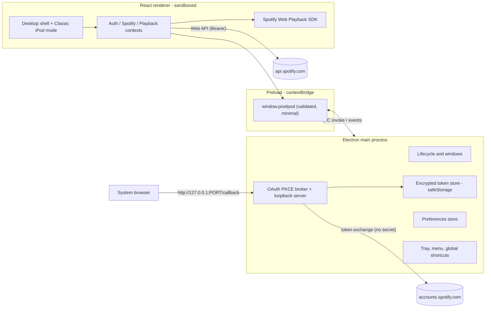

# PixelPod Desktop — Architecture & Decisions

This document records the Phase 1 repository audit and the architecture decisions
for migrating PixelPod to an Electron desktop application.

---

## 1. Audit — Existing State (before migration)

| Layer | Technology |
|---|---|
| Renderer | React 18 + Vite 5, vanilla CSS with custom properties |
| Auth | Spotify Authorization Code + PKCE, brokered by an Express server (`server/index.js`) that also sends the **client secret** |
| Desktop | Uncommitted Tauri v2 experiment: Express compiled into a sidecar `.exe`, `pixelpod://` deep link |
| Playback | Spotify Web Playback SDK (`PlaybackContext`) + Web API (`playbackService`) |
| Tests | Vitest + Testing Library (22 tests, services + App integration) |

### What works and must be preserved

- PKCE login, CSRF `state` validation, silent token refresh, scope checks.
- Profile, playlists (paginated), playlist tracks, liked songs, search (tracks/albums/artists).
- Playback: context playback (playlists), custom URI queue (liked songs) with local shuffle,
  shuffle / repeat / seek / volume, album-art crossfade.
- Click wheel (angular drag, momentum, touch), keyboard map, Web Audio click sounds.
- Classic/Modern themes × Silver/Graphite/Blue skins, persisted.
- Accessibility basics: `aria-live` announcements, focus management, reduced motion.

### Problems found

| # | Problem | Location |
|---|---|---|
| 1 | Client secret required on a local server → would ship inside a desktop binary | `server/index.js`, Tauri sidecar |
| 2 | Tokens stored in `localStorage` (plain text) | `utils/spotifyAuth.js` |
| 3 | `initializingRef` never reset after successful SDK init → no re-init after logout/login | `PlaybackContext.jsx` |
| 4 | `togglePlayPause` asymmetric (pause via Web API, resume via SDK) | `PlaybackContext.jsx` |
| 5 | 1 s polling runs even when idle/paused | `PlaybackContext.jsx` |
| 6 | SDK `<script>` may be appended more than once | `PlaybackContext.jsx` |
| 7 | `next`/`previous`/`seek` only work through the local SDK player | `PlaybackContext.jsx` |
| 8 | ~40 props drilled App → IPod → Screen | `App.jsx` |
| 9 | Library data fetched once, never refreshed | `App.jsx` |
| 10 | No tests for `spotifyAuth`, contexts, navigation/queue hooks | tests |

---

## 2. Target Architecture



### Process responsibilities

- **Main** (`electron/main/`): app lifecycle, single-instance lock, window state, tray,
  application menu, global media shortcuts, notifications, login-item settings,
  OAuth broker, encrypted token storage, preferences. Owns the refresh token —
  it never crosses into the renderer.
- **Preload** (`electron/preload/`): exposes a frozen `window.pixelpod` object with a
  fixed list of functions. No `ipcRenderer` passthrough, no Node APIs.
- **Renderer** (`src/`): all UI. Requests short-lived access tokens from main
  via `pixelpod.auth.getAccessToken()`.

### Security settings

- `contextIsolation: true`, `nodeIntegration: false`, `sandbox: true`, `webSecurity: true`.
- Strict CSP (served in `index.html` + response header in production):
  scripts only from `self` and `https://sdk.scdn.co`; connections only to Spotify domains.
- Navigation/window-open guards: in-app navigation outside the app origin is blocked;
  `https:` links open in the system browser.
- Every IPC handler validates the sender frame and payload shape.
- Spotify app runs as a **public PKCE client** — no client secret anywhere.

---

## 3. Key Decisions

### D1 — Electron replaces Tauri and the Express server
TODO2 mandates Electron. Electron lets the main process do the PKCE exchange in
Node, which removes the need for the Express auth proxy and its client secret.
The Tauri experiment was never committed; it will be removed once Electron
reaches feature parity.

### D2 — Authentication: PKCE public client + loopback redirect
Spotify (since 2025) rejects `localhost`; HTTP redirects are only accepted for
loopback IP literals. PixelPod uses:

```
http://127.0.0.1:43821/callback
```

The main process starts a one-shot HTTP listener bound to `127.0.0.1` only when a
login is in progress, opens the authorize URL in the **system browser**
(`shell.openExternal`), validates `state`, exchanges the code with the PKCE
verifier (no secret), then closes the listener. The port can be overridden via
`PIXELPOD_OAUTH_PORT`.

**Client ID**: not confidential under PKCE, but user-specific. Resolution order:
`SPOTIFY_CLIENT_ID` env var (dev `.env`) → value entered by the user in the app
(stored in preferences). Nothing is hardcoded.

### D3 — Token persistence via Electron `safeStorage`
Tokens are encrypted with `safeStorage` (DPAPI on Windows, Keychain on macOS,
libsecret/kwallet on Linux) and written to `userData/tokens.bin`. If OS encryption
is unavailable, tokens are kept in memory only (user logs in each launch) — never
written in plain text.

### D4 — Playback: OEM VMP Browser Audio Host + Web Playback SDK + Spotify Connect fallback
The Web Playback SDK requires both **Widevine CDM** (EME) and an **OEM-production Verified Media Path (VMP)** signature. Spotify's `/v1/widevine-license/v1/audio/license` endpoint rejects castLabs' development VMP signature after the ~1.5-second unencrypted track lead-in.

- **Primary (Desktop)**: `electron/main/audioHost.js` hosts Spotify's official `https://sdk.scdn.co/spotify-player.js` inside an invisible, isolated `--headless=new` worker of an installed OEM-certified Chromium browser (Microsoft Edge on Windows, or Google Chrome / Brave across platforms) connected over a per-session secret-authenticated `127.0.0.1` loopback channel, with SMTC disabled in the worker so Electron exclusively owns OS media keys and tray controls.
- **Secondary / Web**: in-window Web Playback SDK via castLabs ECS when running in a browser or without a host binary.
- **Fallback (always available, supported by Spotify)**: **Connect remote mode** —
  if no local SDK device can initialise, PixelPod controls an existing Spotify device
  (desktop app, phone, speaker) via the Web API (`/me/player/*`), polling
  `GET /me/player` for state. The UI explicitly shows which device is playing and
  offers a device picker. No fake playback.

Both modes require Spotify Premium for playback control (Spotify restriction).

### D5 — One playback state
`PlaybackContext` remains the single source of truth. All controls go through the
Web API with the active device id, so they work identically in SDK and Connect mode.
The bottom player, Now Playing, Classic mode, tray, media keys and `navigator.mediaSession`
all read from / dispatch to this context.

### D6 — Navigation
Desktop mode uses a lightweight in-app router (state-based, no new dependency).
Classic Mode keeps the existing `useNavigation` screen stack and click wheel, rendered
in a dedicated view that shares the same contexts.

### D7 — Dependencies added (minimal)
`electron` (ECS build), `electron-builder`, `lucide-react` (icons, requested by spec),
`concurrently`/`wait-on` for dev orchestration. Removed: `express`, `axios`, `cors`,
`dotenv`, Tauri packages, `@yao-pkg/pkg`.

